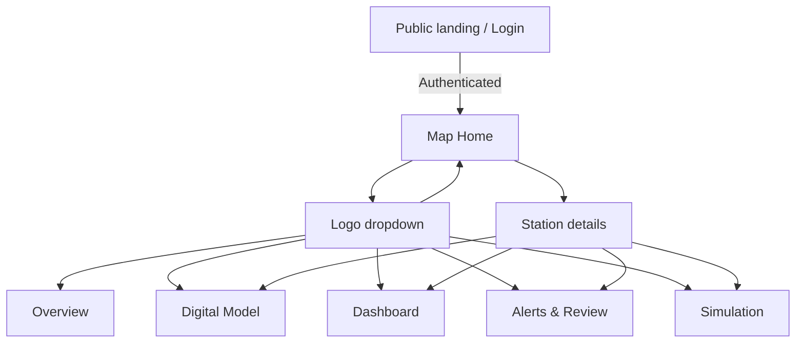

# HanoiWaterWatch — UI/UX Design Specification

> **Design direction:** Map-first environmental intelligence  
> **Target:** Responsive web application for laptops, tablets and mobile phones  
> **Audience:** Product designers, frontend engineers, AI coding agents and project teammates  
> **Status:** Proposed redesign; preserve existing application functionality and data contracts.

---

## 1. Product vision

HanoiWaterWatch (HWW) should feel like a modern environmental monitoring command centre rather than a traditional administrative website. Users should understand the condition of Hanoi's waterways, locate monitoring stations, investigate alerts, explore the digital model and run simulations without losing geographic context.

The application has two distinct experiences:

- **Public entry:** A cinematic, video-background login page that introduces the identity of HanoiWaterWatch.
- **Authenticated workspace:** A fast, practical, map-first monitoring environment, with navigation integrated into the logo at the top of the interface.

### Design principles

1. **Map first:** The authenticated home is an interactive map, not a collection of dashboard cards.
2. **Progressive disclosure:** Show the most important information immediately; reveal detailed information when requested.
3. **Consistent navigation:** Every primary module is accessible through a single logo-based dropdown menu.
4. **Responsive by design:** Adapt the interface for touch, smaller displays and laptop workflows, rather than simply shrinking the desktop UI.
5. **Environmental clarity:** Use colour, labels and spatial context to make conditions understandable without exaggerating their severity.
6. **Trustworthy intelligence:** Clearly distinguish observed sensor readings, derived indicators, predictions and simulated results.

### Scope and assumptions

This document specifies a responsive web application. A native iOS/Android build, installation as a PWA and offline operation are optional extensions, not implied requirements. Existing backend functionality, authentication, station schemas, digital models and simulation capabilities remain the source of truth. The design assumes that a geographic map and station records are available; any new fields or workflows described below require confirmation against the existing implementation.

---

## 2. Information architecture



| Screen | Proposed route | Purpose |
| --- | --- | --- |
| Login | `/login` | Authenticate and introduce HWW. |
| Map Home | `/app/map` | Primary spatial monitoring workspace. |
| Overview | `/app/overview` | Summarise citywide monitoring and system status. |
| Digital Model | `/app/digital-model` | Explore the existing digital representation of waterways and monitoring assets. |
| Dashboard | `/app/dashboard` | Analyse measured values, historical trends and comparisons. |
| Alerts & Review | `/app/alerts` | Investigate, review and track alerts. |
| Simulation | `/app/simulation` | Configure scenarios and inspect modelled results. |

These routes are conceptual. Reuse existing paths where possible and provide redirects if routes change. Map Home is separate from Overview: the former answers *where is the problem?*, while the latter answers *what is happening across the system?*

Keep selected station, time range and relevant filters when navigating between related modules. Support browser back/forward navigation and deep links to a station or alert where the existing data model permits.

---

## 3. Visual identity and design system

### 3.1 Art direction

**Theme: Urban Water Intelligence.** Combine the visual language of environmental science, geographic information systems and a contemporary SaaS workspace. Use dark navy, clean neutral surfaces and restrained teal accents. Avoid excessive glassmorphism, gradients, decorative charts and visually noisy cards.

Use a cinematic dark appearance on the login page, with a light operational workspace by default. An optional dark workspace can be added through semantic theme tokens after the light experience is complete. Basemap styling should remain legible independently of the UI theme.

### 3.2 Colour tokens

| Token | Hex | Application |
| --- | --- | --- |
| `--brand-navy` | `#10243A` | Brand, login overlay, primary text on light surfaces |
| `--brand-teal` | `#007C83` | Primary controls, selected navigation, links |
| `--brand-aqua` | `#41D9CF` | Login highlights, accent graphics on dark surfaces |
| `--bg` | `#F3F6F8` | Workspace background |
| `--surface` | `#FFFFFF` | Panels, dialogs, cards |
| `--text` | `#172B3A` | Main text |
| `--text-muted` | `#526575` | Supporting text |
| `--border` | `#DCE4EA` | Dividers and borders |
| `--normal` | `#137D54` | Normal condition |
| `--watch` | `#986000` | Warning / watch condition |
| `--critical` | `#B42332` | Critical condition |
| `--unknown` | `#64748B` | Unknown, stale or unavailable data |
| `--simulation` | `#6B46C1` | Simulated values and scenario layers |

Status colours must be accompanied by labels, marker shapes or icons. Test contrast in actual component combinations; do not assume every token pairing passes WCAG. Use the existing validated domain thresholds, never invented pollution limits.

### 3.3 Typography and spacing

- Font: Inter, with a system sans-serif fallback and Vietnamese glyph support.
- Page title: 28–32 px desktop, 22–26 px mobile; weight 600–700.
- Section heading: 18–20 px; body text: 14–16 px; supporting labels: 12–14 px.
- Use tabular numerals for sensor readings and consistent unit formatting.
- Spacing scale: 4, 8, 12, 16, 24, 32, 48, 64 px.
- Panel radius: 12–16 px; input/button radius: 8–12 px.
- Use thin borders and subtle shadows. Reserve elevated shadows for overlays and popovers.
- Icons: a consistent outline icon set, preferably the one already used by the project. Use visible labels for ambiguous actions.

---

## 4. Global application shell and logo navigation

### 4.1 Workspace navigation

On `/map`, the full-viewport map carries an independently floating logo centered horizontally at the top, a station search control at the upper left, and separate circular notification and account buttons at the upper right. The surrounding overlay passes interactions through to Leaflet. Content routes retain their compact sticky header and the same logo disclosure and account actions.

The six navigation links form a flat vertical list with active-route styling. Open and close use a 300–450 ms cascade, with entries staggered by 30–50 ms and reverse order on close. Escape returns focus to the trigger. Outside interaction and route selection dismiss the list. Reduced motion shows the final state immediately.

### 4.1a Content-page header reference

Content pages use a compact sticky header for the logo and utility controls. The map route uses the independent floating controls described above.

```text
Desktop
┌──────────────────────────────────────────────────────────────────┐
│ [HWW logo ▾]  HanoiWaterWatch    [Search]    [Alerts] [Profile] │
└──────────────────────────────────────────────────────────────────┘

Mobile
┌─────────────────────────────────┐
│ [HWW logo ▾]     [Search] [●] [Profile] │
└─────────────────────────────────┘
```

The logo/brand lockup is the primary navigation trigger, not a second logo beside an unrelated hamburger menu. Keep the chevron visible to communicate that it opens a menu. A single activation opens navigation; selecting Map Home returns to the map. Do not assign two conflicting click actions to the logo.

### 4.2 Logo dropdown

```text
┌───────────────────────────┐
│ HWW  WORKSPACE        ▴   │
├───────────────────────────┤
│ ◉  Map Home             ✓ │
│ ◫  Overview               │
│ ◇  Digital Model          │
│ ▥  Dashboard              │
│ !  Alerts & Review        │
│ ▷  Simulation             │
└───────────────────────────┘
```

- Desktop: anchored dropdown under the logo; approximately 280–320 px wide.
- Mobile: logo opens a top-anchored, nearly full-width navigation popover or sheet; allow scrolling on short screens.
- Highlight the current route with a tinted background, icon and active indicator.
- Show an unread alert count only if an actual count is available; avoid redundant badges.
- Click/tap to open, Escape or outside interaction to close, route selection to close. Provide keyboard access, clear focus indicators and correct expanded state.
- Avoid hover-only navigation. Use a disclosure button and navigation links, or implement the full keyboard semantics if using an ARIA menu.
- Keep account actions (settings where available, sign out) in the profile menu rather than mixing them with operational modules.

**Navigation constraint:** Do not add a permanent sidebar, desktop navigation tabs or a mobile bottom navigation bar. Contextual panel tabs and in-page controls are allowed; all primary destinations remain in the logo dropdown.

---

## 5. Public landing page and login experience

### 5.1 Desktop layout

Create a full-viewport cinematic entry screen. A video of Hanoi's waterways, rivers, urban landscape or relevant environmental monitoring activity fills the background. Use licensed or project-owned footage. Apply a navy gradient overlay so text and form fields remain readable across all video frames.

```text
┌─────────────────────────────────────────────────────────────────┐
│ [HWW LOGO]                                      [Language*]    │
│                                                                 │
│      HANOI WATERWATCH               ┌───────────────────────┐   │
│      See the city through           │ Welcome back          │   │
│      its waterways.                 │ Sign in to HWW         │   │
│                                     │ Email / Username       │   │
│      Monitor. Understand.           │ Password           ◉   │   │
│      Respond.                       │ [     Sign in     ]    │   │
│                                     │ [Recover access*]     │   │
│                                     └───────────────────────┘   │
│ [Pause background]                               [Attribution] │
└─────────────────────────────────────────────────────────────────┘
* Only expose supported functionality.
```

Use a left-aligned brand statement and a right-side login card, approximately 400–440 px wide. The login card may use a subtle translucent dark surface with a solid fallback, but form fields and text must maintain contrast. Preserve the current authentication flow and field requirements. Do not add unsupported registration, OAuth or password-recovery flows.

### 5.2 Mouse-movement animation

The pointer interaction should feel like moving across the surface of water, not like a distracting cursor effect.

- Use 🧼 over the underwater entry and the native cursor over the sign-in card. Outside the card, show 🫧 on a primary press and briefly after release. Keep the form and text stationary.
- Use CSS transforms/opacity and `requestAnimationFrame` where needed; update decorative elements without re-rendering the whole page.
- Enable pointer effects only for fine-pointer devices. Disable them for touch devices and reduced-motion preferences.
- Keep the cursor overlay transparent to clicks. Use the native cursor on the operational map and when reduced motion is enabled.
- Keep animated layers `pointer-events: none` and hidden from assistive technology.

### 5.3 Background video and mobile behaviour

- Use a muted, looping, inline video with a compressed WebM/MP4 source and a poster image.
- Avoid autoplay audio. Provide a visible pause/play control and use a static poster for reduced-motion preferences or when autoplay fails.
- Treat video as decorative; the login must be usable before it downloads and when video is disabled.
- On mobile, prioritise the login form: compact branding above a full-width card, generous touch targets, scrollable layout and safe-area padding.
- Use a static poster on low-bandwidth or data-saving connections where detectable; optional lightweight video on capable mobile devices.
- Use `min-height: 100dvh` with an appropriate fallback rather than forcing a rigid height that clips the form when the keyboard opens.

### 5.4 Authentication states

Design default, focus, password-visible, validation error, submitting, authentication failure, network error and success states. Avoid exposing whether a specific account exists in error messages where authentication policy requires it. Prevent duplicate submissions. After successful login, open Map Home unless a valid protected deep link should be restored.

---

## 6. Map Home — primary workspace

### 6.1 Full-viewport composition

The basemap covers the full dynamic viewport. On the homepage, geographic information is prioritized through a compact floating status label, an accessible simulated-data disclosure, and independent circular controls. The station inspector is a floating side surface on wide displays and a compact bottom sheet on mobile. Reposition the toolbar, map scale and attribution to stay above the sheet. Keep notices and overlay panels clear of essential controls.

A single circular Map tools button sits at bottom left. Open it to reveal an upward cascade of existing tools: zoom in/out, fit stations, station list, filters, layers and legend. Show each secondary panel within the same floating area and bound its height to the available viewport. Use flat lists and independently scrollable surfaces that contain wheel/touch scrolling. Use 44–48 px circular controls on desktop and 48–52 px on mobile. Search is also available as a floating shortcut. A concise freshness label and simulated-data disclosure replace the former status and provenance bars.

On entry, fit Hanoi's monitored stations or the configured area of interest. Ask for device location only if a supported action needs it. Show station details after selection and keep the selected pin in the visible map area.

### 6.2 Map controls and data layers

- Search for actual station names, IDs or configured waterway names; selecting a result focuses the map and opens details.
- Provide filters for available station status, monitoring parameter, alert severity and location. Reflect active filters and allow a single reset.
- Offer available layers such as stations, waterways, alerts and explicitly labelled simulation overlays. Expose heatmaps or sensor coverage only if supported by valid data.
- Zoom, fit monitored locations, and show a collapsible legend. Optional locate-me requires explicit permission and is never necessary to view Hanoi.
- Include basemap attribution, timestamp/freshness information and a clear distinction between filtered results and all stations.
- Cluster dense markers at lower zoom levels and reveal station-level details as the user zooms in.
- Avoid camera jumps during periodic data updates. Preserve user-controlled zoom, pan and selection.

### 6.3 Station marker system

| Condition | Marker treatment |
| --- | --- |
| Normal | Green circle + normal label in details |
| Warning | Amber diamond + warning icon |
| Critical | Red triangle + alert icon |
| Stale / unknown / offline | Grey outlined marker + explicit availability state |
| Selected | Outer focus ring independent of status colour |
| Simulated | Separate purple overlay/marker with a simulation label |

Map marker status is derived from the existing validated status logic, not inferred from arbitrary frontend thresholds. Missing data is never displayed as safe, normal or zero. If no status is available, show unknown.

### 6.4 Selected station panel

Order content by usefulness:

1. Station name, identifier, waterway and status.
2. Last measured time, connectivity or data freshness where available.
3. Latest readings with units, status and reference ranges if validated.
4. Compact historical trend preview and related active alerts.
5. Contextual actions: open full dashboard, inspect related alert, explore digital model or open simulation with selected station context if supported.

Avoid presenting every metric simultaneously. Use a clear unavailable state for missing fields. If supported, include a keyboard-accessible list of map results as an alternative to interacting with markers.

### 6.5 Mobile map

Keep the full-viewport canvas, compact centered droplet logo, independent circular account and notification controls, and the bottom-left map-tools disclosure. Use device safe-area insets. Keep notification and navigation lists independently scrollable on short screens. A selected station opens a collapsible bottom sheet. Keep the tool trigger, scale and attribution above the sheet, preserve horizontal fit, and let users scroll the inspector without moving the map.

---

## 7. Module specifications

All modules share the global logo navigation, visual tokens and reusable states. The exact displayed fields and interactive actions depend on the existing HWW implementation.

### 7.1 Overview — system-wide snapshot

- Top: heading, time range, data freshness and optional refresh action.
- Summary: monitored stations, active alerts, stations requiring attention and data coverage, using real values only.
- Main area: citywide status distribution, recent significant events and monitoring summary. Include a compact geographic preview only if useful; it must link back to Map Home.
- Desktop: responsive KPI row and two-column content. Mobile: stacked KPI tiles and vertically ordered sections.
- Primary action: inspect a station or alert in its relevant module.

### 7.2 Digital Model — spatial/system representation

- Main viewport: preserve the existing digital model, including its 2D/3D representation if implemented.
- Desktop: model canvas with collapsible layer controls and contextual inspector. Mobile: model viewport with expandable inspector sheet and simplified controls.
- Show the selected object, related station data, connection information and model timestamp where available.
- Provide reset view, selection and layer visibility controls supported by the existing renderer.
- Clearly label model-derived information. Do not imply that every model state is real-time or physically validated.
- If the renderer cannot operate on a device, offer an informative fallback view instead of an empty canvas.

### 7.3 Dashboard — measurement analytics

- Filters: station/waterway, parameter, date range and any available comparison controls.
- Layout: key readings, time-series chart, comparison or distribution chart when applicable, and detailed data table.
- Show chart units, time zone, axis labels, timestamps and data gaps. Do not interpolate missing sensor data without explicitly labelling the interpolation.
- Provide threshold lines only from validated reference values. Offer measured/estimated/simulated series labels if applicable.
- Desktop: 12-column analytical grid. Mobile: prioritised single-column charts, touch-friendly filters and accessible data summaries.
- Existing export controls may be retained if functional; do not add non-functional export buttons.

### 7.4 Alerts & Review — investigation workspace

- Desktop: filterable alert list with selected-alert detail pane. Mobile: alert cards leading to a full detail view or sheet.
- Alert items show severity, station, event time, trigger reason and review state when available.
- Detail includes triggering observation, supporting evidence, related station history and relevant map location.
- Separate **environmental severity** from **review workflow state**. For example, a reviewed critical alert can still be critical.
- If backend support exists, provide authorised acknowledgement/review/resolution actions, reviewer notes and an audit trail. Confirm consequential actions and surface errors without falsely marking them complete.
- Allow users to open the associated station on Map Home with context preserved.

### 7.5 Simulation — scenario workspace

Use an explicit workflow: **Configure → Run → Inspect → Compare**.

- Configuration panel: existing model inputs, supported location, time horizon and scenario parameters; display units and valid input constraints.
- Run action: validate inputs, show actual run status and prevent duplicate requests. Offer cancellation only if supported.
- Results: modelled geographic overlay, chart/table, baseline comparison and scenario metadata when provided by the simulation engine.
- Use purple or clearly differentiated patterns for modelled outcomes; never overwrite observed station status with scenario predictions.
- Record and display run time, model version, assumptions and uncertainty if provided. Do not fabricate confidence intervals.
- Desktop: configuration panel beside results. Mobile: sequential step flow with expandable output; preserve inputs on orientation changes.
- If no simulation exists yet or the run fails, show a truthful empty/error state rather than sample outputs disguised as results.

---

## 8. Responsive layout rules

Use CSS media queries based on available viewport width; adapt to content when it no longer fits, rather than assuming fixed device sizes.

| Range | Main layout | Map detail | Navigation |
| --- | --- | --- | --- |
| < 600 px | Single column, compact header | Bottom sheet | Logo-triggered full-width popover/sheet |
| 600–1023 px | Flexible one/two columns | Compact side panel or bottom sheet | Logo dropdown |
| 1024–1439 px | 12-column desktop grid | 320–380 px side panel | Anchored logo dropdown |
| ≥ 1440 px | Expanded desktop grid; full-width map | Resizable/collapsible panel if useful | Anchored logo dropdown |

- Header height: approximately 56 px on mobile, 64 px on desktop.
- Aim for 44 × 44 px minimum primary touch targets; maintain WCAG 2.2 AA minimum target-size requirements and spacing.
- Workspace pages use 16 px mobile and 24–32 px desktop gutters; map remains full-bleed.
- Handle mobile safe areas, landscape orientation, browser address bars and virtual keyboards.
- Tables may scroll horizontally in a labelled region or transform into cards when semantic meaning remains intact; the entire page must not overflow horizontally.
- Do not remove essential functions merely because the viewport is narrow.

---

## 9. Motion and interaction system

| Interaction | Motion guideline |
| --- | --- |
| Logo and map tool dropdowns | 300–450 ms opacity, short translation and clipping; 30–50 ms stagger with reversed exit |
| Panel and bottom sheet | 180–250 ms ease-out |
| Buttons and inputs | 100–150 ms colour/focus transitions |
| Map focus on selected station | Short, controlled camera transition; reduced-motion instant alternative |
| Login cursor effect | Lightweight, continuous decorative movement only while active |
| Loading | Skeleton for predictable layout; actual progress only when supplied by the system |

Respect `prefers-reduced-motion`. Avoid unnecessary motion, looping operational effects, layout shifts and flash-heavy alert indicators. Critical alerts should be prominent through static colour, icon and text rather than perpetual blinking.

---

## 10. Data integrity, AI and application states

### 10.1 Trust and data provenance

Every data visualisation should identify its source type where meaningful:

- **Observed:** sensor or verified measurement, with timestamp and units.
- **Derived:** computed metric, with method or definition where available.
- **Predicted:** model inference, with horizon/model context and uncertainty where actually provided.
- **Simulated:** scenario output with assumptions; not a measured condition.

If AI features already exist, keep their output advisory and grounded in authorised application data. Display evidence, missing inputs and uncertainty when supplied. AI-generated summaries must not silently change sensor readings, operational alert severity or review decisions. No new AI assistant or prediction engine is required by this redesign.

### 10.2 Standard states

| State | UI behaviour |
| --- | --- |
| Initial loading | Preserve layout using skeletons; show map loading independently. |
| Refreshing | Retain previous valid data and show refresh indicator. |
| No results | Explain that current filters match no records; offer reset. |
| No data | Show unavailable state and relevant context; no fabricated metrics. |
| Stale data | Show last successful update and clearly mark age/status. |
| Network failure | Show a retry action; preserve previously loaded data only with a stale indicator. |
| Permission denied | Explain unavailable access without exposing protected data. |
| Successful action | Confirm only after the backend reports success. |

Use explicit freshness semantics from the existing backend or validated configuration. Never label data live simply because the page is open. Respect role-based access in both frontend and backend; never rely on hiding a button as the only security control.

---

## 11. Technical implementation guidance

### 11.1 Stack and architecture

Prefer incremental redesign within the current frontend, preserving the existing backend, data stores, API contracts and application logic. If the frontend already uses React and TypeScript, the structure below is suitable. If not, adapt its responsibilities to the current framework rather than introducing a migration solely for visual changes.

Use the existing map library if capable. MapLibre GL JS (vector maps) or Leaflet (lighter 2D maps) are possible alternatives only if the current mapping solution cannot meet requirements. Verify tile-provider terms, attribution, licensing and data availability before changing providers. Reuse the current charting and digital model libraries where practical.

```text
src/                         # Illustrative structure, not mandatory migration
├── app/
│   ├── routes/
│   ├── AppShell.tsx
│   └── providers/
├── components/
│   ├── ui/
│   ├── navigation/
│   │   ├── AppHeader.tsx
│   │   └── LogoNavigation.tsx
│   ├── map/
│   │   ├── MapCanvas.tsx
│   │   ├── MapToolbar.tsx
│   │   ├── StationMarker.tsx
│   │   ├── MapLegend.tsx
│   │   └── StationDetails.tsx
│   └── feedback/
├── features/
│   ├── auth/
│   │   ├── LoginPage.tsx
│   │   └── LoginBackground.tsx
│   ├── map-home/
│   ├── overview/
│   ├── digital-model/
│   ├── dashboard/
│   ├── alerts-review/
│   └── simulation/
├── services/                # Existing API integration / adapters
├── hooks/
├── types/
├── styles/
│   ├── tokens.css
│   └── globals.css
└── assets/
    ├── logo/
    └── video/
```

### 11.2 State and integration

Separate server-derived data from temporary UI state. Reuse the current query/cache solution; centralise selected station and shared filters where needed, preferably with URL state for shareable context. Keep transient popovers, sheets and pointer animation local. Use adapters only when existing schemas require UI-friendly transformations; do not create duplicate domain models without need.

Route-protect operational screens through existing authentication. Do not expose secrets in client assets or logs. Preserve server-side validation and authorisation for all operational actions.

### 11.3 Performance and accessibility

- Lazy-load the digital model and simulation modules, and load the map only on relevant routes.
- Keep heavy login video assets out of the authenticated workspace bundle; use an optimised poster and deferred video loading.
- Cluster/virtualise dense station markers and long lists; avoid destroying the map on every filter change.
- Cancel or ignore obsolete network responses when users change filters rapidly; clean up event listeners and animation frames.
- Use semantic controls, accessible names, keyboard focus management, form labels and meaningful error announcements.
- Target WCAG 2.2 AA; test keyboard-only operation, screen-reader navigation, zoom and reduced motion. Provide map data in a non-map list/table form where feasible.
- Proposed quality targets: LCP ≤ 2.5 s, INP ≤ 200 ms and CLS ≤ 0.1 at the 75th percentile where measurable, with representative mobile testing. These are targets, not verified current performance.

---

## 12. Implementation plan

| Phase | Work | Exit criteria |
| --- | --- | --- |
| 0 — Audit | Identify actual routes, framework, authentication, API fields, map library, existing features and permissions. Capture current screenshots and tests. | Feature inventory and integration constraints documented; no existing functionality lost. |
| 1 — Foundation | Design tokens, reusable primitives, responsive shell, logo dropdown and route integration. | All modules reachable on desktop/mobile and keyboard. |
| 2 — Map Home | Default authenticated map, filters, search, legend, markers, inspector and mobile sheet. | Existing station data displays correctly; map interactions work at target widths. |
| 3 — Login | Video/poster background, branding, responsive form, pointer animation and reduced-motion alternatives. | Authentication works with video disabled; no mobile keyboard clipping. |
| 4 — Modules | Restyle Overview, Digital Model, Dashboard, Alerts & Review and Simulation using shared patterns. | Existing workflows and contextual navigation verified; data types labelled correctly. |
| 5 — QA | Cross-device accessibility, performance, error states, regression and security testing. | Acceptance checklist passes or remaining issues are explicitly documented. |

---

## 13. Acceptance checklist

- [ ] Public entry is a login screen with a cinematic video or fallback poster.
- [ ] Mouse movement produces subtle decorative animation on supported devices; reduced-motion and touch users are not forced to see it.
- [ ] Existing authentication and valid deep links continue to work.
- [ ] After login, the default screen is the interactive Hanoi map.
- [ ] The top logo opens a clearly discoverable dropdown containing all six destinations.
- [ ] No permanent sidebar, separate primary navbar or mobile bottom navigation is introduced.
- [ ] Station selection, available filters, search and map layers are usable with pointer and touch.
- [ ] Desktop station details and mobile bottom sheets work without obscuring essential controls or attribution.
- [ ] Overview, Digital Model, Dashboard, Alerts & Review and Simulation retain their existing functional behaviour.
- [ ] Observed, derived, predicted and simulated values are not misrepresented or mixed silently.
- [ ] Missing, stale, offline and error data states are visibly distinguishable from normal conditions.
- [ ] Layouts work at 360, 390, 768, 1024, 1280 and 1440 px, including landscape and mobile keyboard use.
- [ ] Keyboard navigation, focus visibility, screen-reader labels, colour contrast and reduced-motion behaviour are tested.
- [ ] Background assets are licensed, optimised and non-blocking; map attribution is retained.
- [ ] No unsupported features, fabricated backend responses, invented sensor thresholds or non-functional placeholder controls appear in production.

---

## 14. Instructions for an AI coding agent

Implement this redesign incrementally in the existing HanoiWaterWatch repository. Read the current README, dependency manifests, routing setup, component structure, authentication logic, service layer and tests before modifying files. Use this specification as the visual and interaction target; use the existing code as the authority for actual functionality.

First identify the current routes, data fields and reusable components, then propose the smallest coherent file-level changes. Do not delete existing features, reset the project, migrate frameworks, change backend contracts or install unnecessary dependencies. Preserve existing Digital Model and Simulation functionality. Do not implement mock readings or artificial alert counts as production data.

Build the common shell and logo navigation first, then Map Home, then the login experience and the remaining module layouts. Use reusable semantic tokens and responsive components, not separate duplicate desktop/mobile applications. If a proposed control needs an unsupported backend capability, omit it or explicitly document it as a future enhancement. If no video has been supplied, implement an accessible poster fallback and a configurable video source without claiming a final media asset exists.

Run existing lint, type-check, build and test commands after changes. Test representative mobile and desktop dimensions, auth navigation, map selection, data freshness, error states and simulation separation. Summarise files changed, verification performed, known limitations and any outstanding design or backend decisions.

**Desired final outcome:** A cohesive, professional, map-first environmental intelligence platform with a cinematic public entry, discoverable logo navigation and a genuinely responsive monitoring workspace.
## 15. Full-screen map homepage acceptance

- [x] Leaflet occupies the dynamic viewport, with a horizontally centered fixed logo and no permanent map-page bar or sidebar.
- [x] The logo discloses six flat links with a staggered downward cascade and reversed closing sequence. Keyboard, touch, outside dismissal and reduced motion work.
- [x] Independent circular notification and account controls stay accessible. The notification list shows existing alert records and links to Alerts & Review.
- [x] The circular bottom-left tools button is the only visible map tool at rest. All supported actions are accessible from its upward cascade and long lists scroll within the viewport.
- [x] Desktop and mobile overlays preserve zoom, pan, selection, attribution, simulation provenance and station data. Compact layouts preserve the map controls alongside the station sheet.
- [x] Production build, type checking, available tests and rendered desktop/mobile inspection pass.
Checked with the local browser suite and rendered desktop and mobile inspection. OpenStreetMap DNS resolution failed in the test environment, so live street tiles remain externally unverified. The coordinate fallback and attribution were inspected.
## 16. Interaction, dashboard and demonstration revision

- Bound menus, station results, inspector details, alert records, chart tables and simulation output to the viewport. Keep controls or titles visible while the list scrolls. Use thin scrollbars and flat shared selected-row styling.
- Anchor station search at the top-left circular control. Expand horizontally on wide screens and below the controls on mobile. Preserve URL station context and filters. Selecting a result moves the Leaflet camera with a reduced-motion alternative. Keep separate circular zoom controls at bottom right.
- Center the shared brand disclosure across content routes. Remove decorative selection checkmarks. Retain functional multi-select controls.
- Use a flat dashboard with animated, scoped current indicators and synchronized historical visuals. Support real station, river, parameter, time range and station comparison. Show status/severity where backed by data, use real units and timestamps, and retain table/CSV access and explicit loading/error states.
- Route data through one frontend provider selected by an explicit central demo flag. Use deterministic synthetic stations, snapshots, history, incidents and replay results. Demo actions preserve role checks and mutate browser state only. Authenticate through the existing session service. Label every demo workspace and distinguish replay outputs from station history.
- Reject the demo flag in production builds. Require an explicit opt-in for a separate local demo build. A normal build excludes the demo provider and never substitutes synthetic data for a failed API.

## 17. Public underwater entry

The anonymous homepage and sign-in route share a local underwater film and matching static poster. The illustrative outfall continuously emits translucent wastewater, individually drifting debris and magnified microorganisms. Pointer motion disturbs nearby trash. A click or tap disperses one microorganism into fragments and a fading ring. Discharge continues independently from these gestures. Content, authentication, station data and the map operate independently from the decorative scene.

The phone composition leaves the pipe visible above the scrollable form. The film and pooled WebGL layer share pause and page visibility state. Reduced motion, constrained devices, data saving, sustained low frame rates and unavailable rendering select the poster.

Trash and microorganism sprites render at 130% of their original size.

Intact trash and microorganisms drift from the outfall past the right edge at a pace that adapts to the viewport width. Clicked microorganisms still disperse into fragments and a fading ring.
